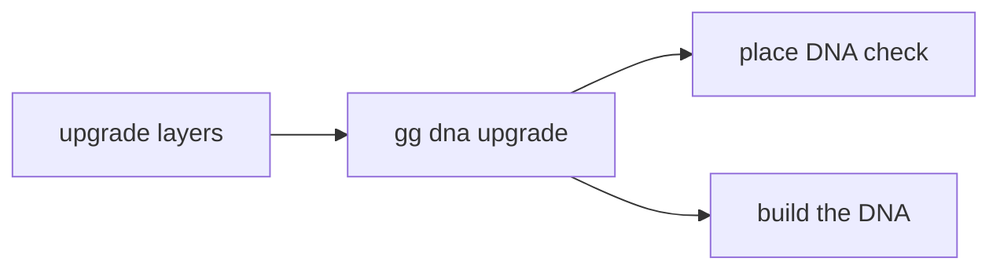

<!--
@license
Copyright (c) ggsuite

Use of this source code is governed by terms that can be
found in the LICENSE file in the root of this package.
-->

# Regenerate the DNA with gg dna upgrade

## Motivation

- `gg do maintain --upgrade-dna` raises the DNA layers of every repo and
  then has to regenerate the DNA with them
- Until now it ran the DNA test of the repo for that. The DNA test now
  only checks that the generated files are unchanged and writes nothing,
  so it can no longer regenerate
- The maintenance run is also the moment every repo should get the newest
  DNA check

## Strategy

- Leave the upgrade of the layer packages as it is
- Replace the second step: run `gg dna upgrade` instead of the DNA test
- Let `gg dna upgrade` decide the details: it places the DNA check that
  fits the repo and instantiates the DNA

## What --upgrade-dna does now

1. `dart pub upgrade --major-versions` (or `flutter`) for the direct
   layers and helix, `dart pub upgrade` for the layers that come through
   another layer
2. `<pm> update --latest` for the TypeScript layers and helix-js
3. `gg dna upgrade` in the repo: a Dart repo gets the Dart check
   `test/dna/dna_test.dart`, a TypeScript repo the vitest check
   `test/dna/dna.spec.ts`; then the DNA is built and committed as
   `#gg: generated DNA`

## Changes

- `UpgradeDna._regenerate` runs `gg dna upgrade` in the repo
- A repo without a DNA test is no longer skipped: `gg dna upgrade` places
  the check when the repo has a test framework
- The tests of `UpgradeDna` expect `gg dna upgrade` as the last call
- README (EN, DE): the table entry of `--upgrade-dna`

## Open Points

- The nightly run (`--nightly`) does not take `--upgrade-dna` along yet
- A first run over all ggsuite repos follows in a ticket of its own
