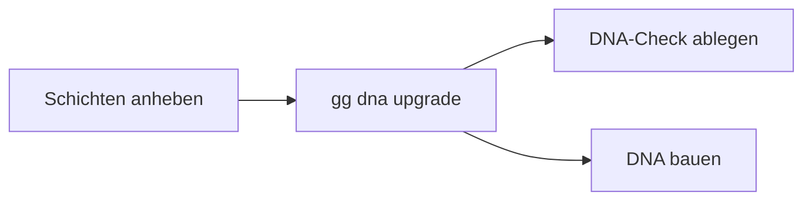

<!--
@license
Copyright (c) ggsuite

Use of this source code is governed by terms that can be
found in the LICENSE file in the root of this package.
-->

# Die DNA mit gg dna upgrade neu erzeugen

## Motivation

- `gg do maintain --upgrade-dna` hebt die DNA-Schichten jedes Repos an und
  muss die DNA danach mit ihnen neu erzeugen
- Bisher lief dafür der DNA-Test des Repos. Der DNA-Test prüft jetzt nur
  noch, dass die generierten Dateien unverändert sind, und schreibt
  nichts — neu erzeugen kann er nicht mehr
- Der Wartungslauf ist auch der Moment, in dem jedes Repo den neuesten
  DNA-Check bekommen soll

## Strategie

- Das Anheben der Schicht-Pakete bleibt, wie es ist
- Der zweite Schritt wird ersetzt: `gg dna upgrade` statt des DNA-Tests
- Die Einzelheiten entscheidet `gg dna upgrade`: Es legt den DNA-Check ab,
  der zum Repo passt, und instanziiert die DNA

## Was --upgrade-dna jetzt tut

1. `dart pub upgrade --major-versions` (oder `flutter`) für die direkten
   Schichten und helix, `dart pub upgrade` für die Schichten, die über eine
   andere Schicht kommen
2. `<pm> update --latest` für die TypeScript-Schichten und helix-js
3. `gg dna upgrade` im Repo: Ein Dart-Repo bekommt den Dart-Check
   `test/dna/dna_test.dart`, ein TypeScript-Repo den vitest-Check
   `test/dna/dna.spec.ts`; danach wird die DNA gebaut und als
   `#gg: generated DNA` committet

## Änderungen

- `UpgradeDna._regenerate` ruft `gg dna upgrade` im Repo auf
- Ein Repo ohne DNA-Test wird nicht mehr übersprungen: `gg dna upgrade`
  legt den Check ab, wenn das Repo ein Test-Framework hat
- Die Tests von `UpgradeDna` erwarten `gg dna upgrade` als letzten Aufruf
- README (EN, DE): der Tabelleneintrag von `--upgrade-dna`

## Offene Punkte

- Der nächtliche Lauf (`--nightly`) nimmt `--upgrade-dna` noch nicht mit
- Ein erster Lauf über alle ggsuite-Repos folgt in einem eigenen Ticket
